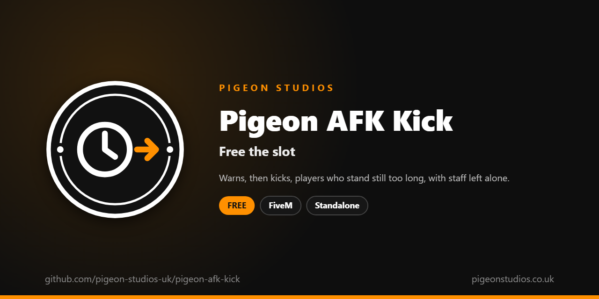

<div align="center">
  

  <h1>Pigeon AFK Kick</h1>

  <p><strong>Warns, then kicks, players who stand still too long, checked on the server, with staff left alone.</strong></p>

  <p>
    <a href="https://github.com/pigeon-studios-uk/pigeon-afk-kick/releases/latest"></a>
    <a href="LICENSE.md"></a>
    <a href="https://discord.gg/2NFVWEUmDF"></a>
    
  </p>

  <p>
    <a href="https://github.com/pigeon-studios-uk/pigeon-afk-kick/releases/latest"><strong>Download</strong></a> ·
    <a href="#installation">Install</a> ·
    <a href="#configuration">Configure</a> ·
    <a href="CHANGELOG.md">Changelog</a> ·
    <a href="https://discord.gg/2NFVWEUmDF">Support</a>
  </p>
</div>

---

## Contents

- [Overview](#overview)
- [Features](#features)
- [Requirements](#requirements)
- [Installation](#installation)
- [Updating](#updating)
- [Configuration](#configuration)
- [Localisation](#localisation)
- [Commands and exports](#commands-and-exports)
- [How it works](#how-it-works)
- [Update checker](#update-checker)
- [Performance](#performance)
- [Security](#security)
- [Troubleshooting](#troubleshooting)
- [FAQ](#faq)
- [Support](#support)
- [Contributing](#contributing)
- [Licence](#licence)
- [Credits](#credits)

## Overview

Pigeon AFK Kick is a free resource by [Pigeon Studios](https://pigeonstudios.co.uk) that frees up slots held by players who've walked away. A full server with a queue, and a dozen characters standing still at the spawn: AFK players take places real players are waiting for, and AFK police and medics leave a scene short of help.

The server keeps an eye on where every player's character is. Anyone who hasn't moved for 15 minutes gets a warning at 5 minutes left and at 1 minute left, then is kicked with a clear message. Staff are left alone, and it can be set to only kick when the server is busy.

## Features

- **Checked on the server.** It reads positions on the server, so a player's game can't fake being active.
- **Warnings first.** On screen with a sound, 5 minutes and 1 minute before, or whenever you choose.
- **A clear kick message.** Players see why they were kicked, in their server's language.
- **Staff left alone.** Anyone with an ACE permission you choose; admins on most servers already have one.
- **Only when it's busy.** Optionally only kick while the server has at least so many players.
- **For other resources.** Exports to read idle time or exempt a player, and an event for logging kicks.
- **23 languages.** Follows ox_lib's language, or set your own.
- **Standalone.** No framework or other resources needed.

## Requirements

| Requirement | Version | Notes |
|---|---|---|
| FXServer | A [recommended artifact](https://runtime.fivem.net/artifacts/) | |
| OneSync | On | The default on current servers |
| [ox_lib](https://github.com/communityox/ox_lib) | Optional | Used for the warnings and the language if it's running |

**Frameworks:** none needed. It works the same on standalone and vMenu servers, ESX Legacy, QBCore, Qbox and ox_core.

## Installation

1. **Download** `pigeon-afk-kick.zip` from the [latest release](https://github.com/pigeon-studios-uk/pigeon-afk-kick/releases/latest). Don't use the green **Code** button; release zips are the tested builds.
2. **Extract** it into your server's `resources` folder. The folder must be called `pigeon-afk-kick`.
3. **Start it** by adding this to `server.cfg`, after ox_lib if you use it:

   ```cfg
   ensure pigeon-afk-kick
   ```

4. **Configure** it in `configuration/config.lua` if you want to change anything. The defaults work as they are.
5. **Restart** your server. The console shows one line from the update checker:

   ```text
   [Pigeon Studios] Pigeon AFK Kick v1.0.0 is up to date.
   ```

## Updating

1. Read the [changelog](CHANGELOG.md) for every version between yours and the latest, especially any **Upgrade notes**.
2. Back up your `configuration/` and `locales/` folders.
3. Replace the `pigeon-afk-kick` folder with the new release.
4. Copy your changed settings into the new `configuration/config.lua`. Don't copy the old file over the new one; new versions can add settings.
5. Restart the resource.

## Configuration

All settings are in `configuration/config.lua`, each explained by a comment next to it.

| Setting | Default | What it does |
|---|---|---|
| `Config.Locale` | `'auto'` | The language. `'auto'` follows ox_lib's; or a code such as `'de'` (see [Localisation](#localisation)) |
| `Config.KickMinutes` | `15` | Minutes standing still before the kick |
| `Config.Warnings` | `{ 5, 1 }` | Warnings, in minutes left before the kick |
| `Config.MinPlayers` | `0` | Only kick while at least this many players are on. `0` always kicks |
| `Config.MinDistance` | `1.0` | Metres a player must move to count as active |
| `Config.MinTurn` | `10.0` | Degrees a player must turn to count as active |
| `Config.ExemptPermissions` | `see below` | ACE permissions that are never kicked: `'pigeon.afkkick.exempt'`, `'command'` and `'admin'` |
| `Config.Notifications` | `'auto'` | `'auto'` (ox_lib if it's running), `'ox_lib'` or `'gta'` |

## Localisation

Pigeon AFK Kick comes in 23 languages: `en` English, `cs` Czech, `da` Danish, `de` German, `es` Spanish, `et` Estonian, `fi` Finnish, `fr` French, `hr` Croatian, `hu` Hungarian, `id` Indonesian, `it` Italian, `nl` Dutch, `no` Norwegian, `pl` Polish, `pt` Portuguese, `pt-br` Brazilian Portuguese, `ro` Romanian, `sl` Slovenian, `sv` Swedish, `tr` Turkish, `zh-cn` Simplified Chinese and `zh-tw` Traditional Chinese. They're the languages ox_lib ships, so your server may already have one set.

With `Config.Locale = 'auto'` (the default), it uses ox_lib's language, so one line in `server.cfg` sets it for this and every other resource that follows ox_lib:

```cfg
setr ox:locale "de"
```

Use `setr`, not `set`, so players' games get it too. Without it, or for a language that isn't in `locales/`, the text is English. To choose a language for this resource only, set `Config.Locale` to its code, such as `'fr'` or `'pt-br'`.

The kick message is in the server's language, set by `ox:locale` on the server or by `Config.Locale`. Chinese text can show as blank in GTA's own text, such as its notifications, because GTA only loads its Chinese font when the game itself is set to Chinese. ox_lib's notifications show every language.

Every file was checked for missing text and placeholders, but not every translation has been read by a native speaker yet. If something reads wrong, please send a fix; see [Contributing](#contributing). To add a language, copy `locales/en.lua` to a new file named with the language's code (such as `ja.lua`), change `Locales.en` at the top to match (`Locales.ja`), and translate the text in quotes.

## Commands and exports

There are no commands. Staff are exempt through ACE permissions.

### Staff

Anyone with one of `Config.ExemptPermissions` is never kicked. The defaults cover most servers already:

| Permission | Who has it |
|---|---|
| `pigeon.afkkick.exempt` | Anyone you give it to |
| `command` | Admins on most servers: txAdmin and the default `server.cfg` give it to `group.admin` |
| `admin` | Admins on Qbox and QBCore |

ESX puts each player in an ACE group named after their ESX group, such as `group.admin`, so ESX admins usually have `command` too. To exempt another group, such as moderators, add a line to `server.cfg`:

```cfg
add_ace group.moderator pigeon.afkkick.exempt allow
```

To kick admins as well, remove `'command'` and `'admin'` from `Config.ExemptPermissions`.

### Exports

Server exports, for other resources:

```lua
-- How long, in seconds, a player has stood still.
local seconds = exports['pigeon-afk-kick']:GetIdleSeconds(source)

-- Never kick this player (true), kick them as normal (false), or go back to the ACE check (nil).
-- For example while they're in a cutscene, a queue or a job that keeps them still.
exports['pigeon-afk-kick']:SetExempt(source, true)
```

### Event

A server event when a player is kicked, for a log or Discord resource:

```lua
AddEventHandler('pigeon-afk-kick:kicked', function(source, minutes)
    print(('%s was kicked for being AFK for %d minutes'):format(GetPlayerName(source), minutes))
end)
```

## How it works

Every 10 seconds, the server looks at each player's character: where it is and which way it faces. If it has moved at least `Config.MinDistance` or turned at least `Config.MinTurn` since the last time it moved, the player is active and their timer starts again. Otherwise their still time goes up.

When the time left reaches each of `Config.Warnings`, the player gets a warning on screen with a sound. At `Config.KickMinutes`, they're kicked with a message saying why, and the `pigeon-afk-kick:kicked` event fires. With `Config.MinPlayers`, nobody is warned or kicked while the server has fewer players than that; once it fills up, anyone already over the limit is kicked at the next check.

Exemptions are checked with `IsPlayerAceAllowed` and remembered for a minute, so a player made staff mid-session is exempt within a minute. The server only knows where players are with OneSync, which is on by default on current servers.

## Update checker

When it starts, Pigeon AFK Kick checks our public [version registry](https://github.com/pigeon-studios-uk/pigeon-versions) once and prints one line in the server console saying whether it's up to date. If there's an update, it shows what's new and where to get it. The check is a single request to GitHub and sends nothing about your server or players.

Control it for every Pigeon Studios resource at once in `server.cfg`:

```cfg
set pigeon_update_check "on"      # default: one line per resource
set pigeon_update_check "quiet"   # only when there's an update or a problem
set pigeon_update_check "off"     # never check
```

## Performance

The server checks every player once every 10 seconds: a position, a heading and a little arithmetic each. Even with hundreds of players, that's far less than a frame's work. Players' games do nothing until they get a warning.

## Security

- All the checking is on the server, from positions the server already has. A player's game can't tell it they're active.
- It has no events players can send. The only network event goes from the server to a player, to show a warning.
- Exemptions come from ACE permissions in your `server.cfg`, which players can't change.
- The only network request is the update check at start-up, from the server to GitHub. It sends nothing about your server or players.

Found a problem? Please don't open a public issue. Use the **Report a vulnerability** button in this repository's **Security** tab, or follow our [Security Policy](https://github.com/pigeon-studios-uk/.github/blob/main/SECURITY.md).

## Troubleshooting

**Nobody gets kicked.**
Check OneSync is on (the server only knows positions with it), and that `Config.MinPlayers` isn't higher than your player count. Admins are exempt by default, so test with a player who isn't staff.

**Staff get kicked.**
Check they have one of `Config.ExemptPermissions`. In the server console, `test_ace player.<id> command` shows whether a player has `command`. Or give their group `pigeon.afkkick.exempt`.

**Players in a long scene get kicked.**
Standing still in a long conversation counts as AFK. Raise `Config.KickMinutes`, or have the resource that keeps them still call `SetExempt`.

**Players in character selection get kicked.**
A player sitting in a menu for 15 minutes is AFK. If your character selection takes longer, have it call `SetExempt(source, true)` and `nil` once a character is picked.

**The text is in the wrong language.**
Check `setr ox:locale` in `server.cfg` (with `setr`, not `set`), or set `Config.Locale` to the language's code.

**The console says "isn't in the version registry" or "couldn't check for updates".**
Your server couldn't reach GitHub, or the check is blocked by a firewall. The resource works normally either way. Turn the check off with `set pigeon_update_check "off"`.

## FAQ

**Is it really free?**
Yes. Use it on as many servers as you like, including ones that take donations. You just can't reupload, resell or bundle it. See [Licence](#licence).

**Does it work on standalone and vMenu servers?**
Yes. It needs no framework at all, and works alongside vMenu.

**Does sitting in a parked car count as AFK?**
Yes. Driving counts as moving; a parked car doesn't.

**Can players get around it by walking in circles?**
Anyone who actually moves is active, so a macro that walks them about will keep them on. It stops the common case: a character left standing still.

**Does it work with txAdmin?**
Yes. It's separate from txAdmin, and txAdmin's admins are exempt by default.

## Support

Read [Troubleshooting](#troubleshooting) first, then ask in the support channels of our [Discord](https://discord.gg/2NFVWEUmDF). Please include your Pigeon AFK Kick version, FXServer artifact and any errors from the console (F8 in game). See [Getting help](https://github.com/pigeon-studios-uk/.github/blob/main/SUPPORT.md).

Found a bug? Open a [bug report](https://github.com/pigeon-studios-uk/pigeon-afk-kick/issues/new/choose).

## Contributing

Fixes, improvements and translations are welcome. Please read the [contributing guide](https://github.com/pigeon-studios-uk/.github/blob/main/CONTRIBUTING.md) first, and open a feature request before working on anything big.

## Licence

Pigeon AFK Kick is free to use under the **[Pigeon Studios Free Licence](LICENSE.md)**.

- ✅ Use it on any number of servers, including monetised ones
- ✅ Change it for your own servers
- ✅ Show it in videos and streams
- ❌ Don't reupload, share or mirror the files; link to this repository instead
- ❌ Don't sell it, bundle it in packs, or put it behind escrow
- ❌ Don't remove the credits

This summary isn't the licence; [LICENSE.md](LICENSE.md) is. Third-party components are listed in [NOTICE.md](NOTICE.md).

## Credits

Made by [Pigeon Studios](https://pigeonstudios.co.uk). Thanks to everyone who has contributed fixes and translations; see the [changelog](CHANGELOG.md).

<sub>Not affiliated with or endorsed by Rockstar Games, Take-Two Interactive or Cfx.re.</sub>
